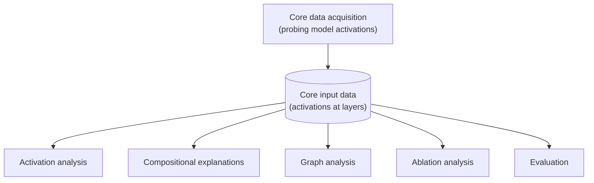

# TaskCE

TaskCE is a research codebase for studying how fine-tuning changes the internal representations of language models. It compares a base model with task-specific LoRA variants by capturing neuron activations and analyzing which internal features remain stable, change behavior, or appear elsewhere in the model.

## Development setup

Install [mise](https://mise.jdx.dev/getting-started.html), then run these commands from the repository root:

```sh
mise trust
mise install
mise run setup
```

mise provides Python 3.12 and uv. The setup task installs the dependencies from `pyproject.toml` into `.venv`. With [mise shell activation](https://mise.jdx.dev/getting-started.html#activate-mise), the existing `.venv` is activated automatically. Commands also work through `mise exec --` without shell activation.

Full dependency setup requires Linux x86_64, including WSL on Windows: the project specifies a Linux-only FlashAttention wheel built for CUDA 12.8 and PyTorch 2.10, along with NVIDIA cuGraph. GPU workloads need a compatible NVIDIA GPU and driver. mise manages Python and uv; system libraries and GPU drivers must be installed on the host.

Use `mise tasks` to list the available commands:

```sh
mise run generate
mise run formula-diff -- --layer /path/to/layer --task snli
mise run formula-viewer -- --formula-diff-dir /path/to/layer/results/formula_diff
mise exec -- uv run --no-sync python
```

The capture script uses the model, dataset, and checkpoint repository configured in `experimental/main.py`. Run it from the repository root with `python experimental/main.py`. The formula tasks operate on existing analysis outputs. Run `mise run setup` after changing dependencies; the workflow tasks use the installed environment without syncing it again. Keep notebook kernels pointed at this repository's `.venv`.

## Research question

Fine-tuning can improve a model's task performance without showing what changed inside the model.

TaskCE studies those internal changes through a more direct question:

> What happens to the model's internal features when it is fine-tuned for a classification task?

The project examines whether features are preserved in the same neurons, modified, reorganized across neurons, or replaced by new task-related behavior.

## Project structure



The project separates collecting core input data from analyzing it. This diagram shows that broad organization rather than dependencies among individual analyses.

## Core data acquisition

The [capture API](experimental/README.md) records selected layers in one inference pass per batch and keeps the results in CPU memory. Run its SNLI entry point with `python experimental/main.py` to capture the base model and latest SNLI LoRA checkpoint. Final-token selection and saving happen separately in `main.py`, producing matrices where each row represents a dataset example and each column represents a neuron.

The capture script currently processes SNLI using the base model and the latest SNLI LoRA checkpoint.

## Analyses

The [analysis code](theoretical/) is organized into the areas below.

### Activation analysis

The [activation analyses](theoretical/activations/) operate directly on saved activation matrices.

- **Threshold coverage** measures how many examples activate each neuron after applying a per-neuron quantile threshold. It helps determine whether enough activation evidence exists for formula search.
- **Task separation** applies PCA to the activation space and measures how examples from different task classes are distributed.
- **Neuron fate** compares base and fine-tuned activation spaces. It measures direct neuron correspondence, affine relationships, cross-model similarity, and possible movement of behavior between neurons.

### Compositional explanations

The [compositional explanation analysis](theoretical/compositional_explanations/) searches for readable formulas that approximate neuron activation patterns. Dataset text is converted into binary token-presence features. These features are combined with logical `AND`, `OR`, and `NOT` operations. Candidate formulas are scored by intersection over union with each thresholded neuron activation vector.

The analysis contains:

- tokenization and feature construction;
- activation thresholding and low-activation pruning;
- symbolic formula rendering and simplification;
- structural comparison of base and fine-tuned formulas;
- CSV and HTML outputs for inspecting formula differences.

#### Search implementations

The [**fully vectorized search**](theoretical/compositional_explanations/new_search/algorithm.py) substantially improves the throughput of the earlier [**batched per-neuron GPU search**](theoretical/compositional_explanations/search/algorithm.py) by vectorizing scoring across neurons, beam states, candidate features, and composition operators. Boolean activation and feature vectors are bit-packed, while [**Triton kernels**](theoretical/compositional_explanations/new_search/kernels.py) perform the IoU calculations directly on the GPU.

The earlier batched implementation substantially reduced the memory requirements of the [**original NLI compositional search**](https://github.com/jayelm/compexp/blob/master/nli/code/analyze.py) by partitioning neurons across workers and batching each neuron's candidate IoU evaluations on the GPU.

### Graph analysis

The [graph analysis](theoretical/graph_analysis/) studies relationships between neurons within an activation space. It constructs neuron graphs from Pearson correlation or cosine similarity, removes weaker edges, detects communities, identifies highly connected neurons, and attaches compositional formulas to the resulting graph structure.

This provides a view of how groups of related neurons are organized before and after fine-tuning.

### Ablation analysis

The [ablation analysis](theoretical/ablation/) tests whether neurons identified by the explanation search affect model behavior. Neurons are ranked using their formula scores and classification weights. Selected groups are then disabled during inference, allowing their effect on task accuracy and class predictions to be measured.

### Evaluation

The [evaluation code](theoretical/evaluation/) compares base and LoRA-adapted models on their classification tasks. It records successful predictions, incorrect predictions, rejected outputs, and overall accuracy. These measurements separate visible task improvement from changes found by the internal analyses.

## Current study

The current configuration primarily studies:

- **Model:** `LiquidAI/LFM2.5-1.2B-Thinking`
- **Fine-tuning:** task-specific LoRA checkpoints
- **Natural language inference:** Stanford SNLI
- **Claim verification:** VitaminC

The evaluation and task-separation components also contain support for the Logical Fallacy dataset.
